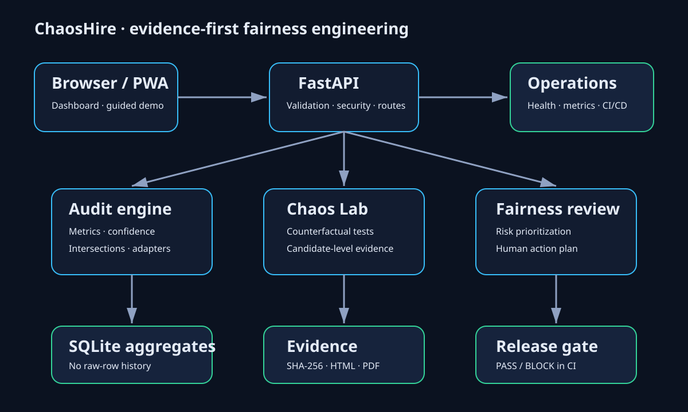

# ChaosHire

### Chaos testing for fair hiring AI

[Live demo](https://chaoshire.onrender.com) · [API docs](https://chaoshire.onrender.com/docs) · [Docs index](docs/README.md) · [Architecture](#architecture) · [Case study](docs/portfolio/PORTFOLIO-CASE-STUDY.md) · [Methodology](docs/engineering/METHODOLOGY.md) · [Privacy](chaoshire/web/privacy.html) · [Terms](chaoshire/web/terms.html)

> Netflix breaks its own servers to find weaknesses before customers do. ChaosHire applies the same idea to automated hiring decisions: stress the model safely before unfair behavior affects real candidates.

> **Visual note:** screenshots retained under `docs/portfolio/assets/` are historical design captures and predate TalentFit v4; they are not current model evidence.

ChaosHire is an open-source fairness-auditing prototype for hiring models. It combines
group-fairness metrics with controlled counterfactual experiments, candidate-level
explanations, mitigation simulations, and an appeals workflow. A fairness dashboard asks
**“Did groups receive different outcomes?”**; ChaosHire also asks **“Would this exact
decision change if only the candidate's identity changed?”**

## Chaos Lab

| Test | Controlled experiment | Risk exposed |
|---|---|---|
| Gender-swap counterfactual | Change gender markers; leave qualifications unchanged | Direct or proxy gender influence |
| Name/community swap | Change community signals; preserve the résumé | Name or community discrimination |
| Privilege-keyword injection | Weak, prestige-heavy synthetic résumés | Résumé gaming and class proxies |
| Career-gap stress | Add a career gap to qualified selected candidates | Penalties affecting caregivers and returners |
| Ageing stress | Re-submit selected younger candidates as 50+ | Hidden age penalties |

Each experiment returns `PASS`, `WARN`, or `FAIL` and feeds a 0–100 **Chaos Resilience
Score**. Two honesty labels change no verdict and no point: passes that **cannot fail**
for the model under test are marked **by construction** (a model that ignores gender
markers cannot flip on a gender swap — that says nothing about equal outcomes), and on
the shipped fixtures the privilege-keyword pass is **fixture-limited**. Every
`/api/chaos` payload reports both; see
[CONTINUOUS-FAIRNESS.md](docs/engineering/CONTINUOUS-FAIRNESS.md).

## Demonstration results

The built-in demo uses a deterministic synthetic population of 1,000 candidates and
three selectable model variants (`legacy` and `fair` are hand-authored fixtures;
`trained` is fitted with scikit-learn at build time and loaded from a pinned artifact):

| Model (API/CLI ID) | Purpose | Fairness risk | Chaos resilience |
|---|---|---:|---:|
| **LegacyCorp Screen v1** (`legacy`) | Intentionally biased test fixture | **32 / F** | **30 / 100** |
| **MeritFirst v2** (`fair`) | Merit-based control fixture | **84 / B** | **100 / 100** |
| **TalentFit v4 (trained)** (`trained`) | Merit-only logistic regression, fairness-prioritised global cutoff | **85 / B** | **100 / 100** |

On the biased fixture, Chaos Lab reports 16.9% decision flips under gender swapping,
11.1% under name/community swapping, 32.7% newly rejected under ageing stress, and 42
qualified candidates incorrectly rejected by LegacyCorp. TalentFit v4 excludes
protected and proxy features and uses one global P(qualified) ≥ 1/4 cutoff. The 3:1
false-rejection operating point was selected from a fixed grid on 49 synthetic tuning
populations with an 80% mean-accuracy guardrail, then checked on a disjoint 50-population
holdout. It improves measured fairness and recall over v3, but lowers accuracy and
advances more unqualified candidates for human review. See the
[methodology guide](docs/engineering/METHODOLOGY.md#fairness-prioritised-model-update-and-its-trade-offs)
for the complete table and limitations, and the
[Fairness Risk Score formula](docs/engineering/METHODOLOGY.md#fairness-risk-score).
All results are synthetic only, not findings about real employers or applicants.

## Capabilities

- Group audits (gender, ethnicity/community, age band, pairwise intersections) with
  disparate impact, demographic-parity and equal-opportunity gaps, Wilson confidence
  intervals, minimum-cell-size warnings, and explicit “not assessable” verdicts
- Reusable counterfactual and stress-test framework with candidate-level before/after
  evidence, additive explanations, decision lookup, and an appeals workflow
- Blind-screening and proxy-removal simulations; per-group threshold “calibration” is
  **not offered as a mitigation** (see
  [42 U.S.C. § 2000e-2(l)](https://www.law.cornell.edu/uscode/text/42/2000e-2)) and is
  only available as a refused-by-default research contrast
- Pluggable decision-adapter contract — audit CSV outcomes without exposing model
  weights — plus named audit IDs and SQLite/PostgreSQL aggregate history
- Model-version comparison and CI/CD fairness release gates with a documented
  synthetic-label accuracy guard, deterministic fairness review, tamper-evident
  SHA-256 evidence bundles, self-contained HTML and native PDF reports
- API-key write protection, optional single-operator private mode, rate limits, a nonce
  CSP, and an accessible dependency-free web/PWA dashboard

## Architecture

A browser-based shell calls FastAPI, which orchestrates audits, chaos experiments,
candidate explanations, reports, evidence, and operations.



### Repository layout

```text
backend.py         # stable uvicorn backend:app entry point
chaoshire/         # application package: routes, services, metrics, chaos, models,
                   # data fixtures, repositories, pinned trained artifact
└── web/           # packaged dashboard served at /
tests/             # api, core, infrastructure, web, and opt-in browser suites
docs/              # engineering, operations, portfolio, and planning guides
scripts/           # CI checks, asset generators, live probes
examples/          # runnable decision-adapter examples
```

See the [documentation index](docs/README.md) and the
[file-by-file inventory](docs/operations/REPOSITORY-INVENTORY.md) for details.

## Quick start

### Python

```bash
git clone https://github.com/dommetipavan26-tech/chaoshire.git
cd chaoshire
python -m venv .venv
source .venv/bin/activate        # Windows PowerShell: .venv\Scripts\Activate.ps1
python -m pip install -r requirements.txt
python -m uvicorn backend:app --reload
```

Open <http://localhost:8000> (interactive API docs at `/docs`).

### Docker

```bash
docker build -t chaoshire .
docker run --rm -p 8000:8000 chaoshire
```

Aggregate audit history defaults to `data/chaoshire.db`; override with
`CHAOSHIRE_DB_PATH` (see [persistence & privacy](docs/operations/PERSISTENCE.md)).

### Tests

```bash
python -m pip install -r requirements-dev.txt
python -m pytest -q
```

GitHub Actions runs linting, type checking, the trained-model drift check, and the test
suite on Python 3.11 and 3.12, with a separate browser workflow. The **current source
baseline**, measured locally, contains **507 tests with 97.0% package coverage**; the
quality gate requires a 90% minimum and the tagged release may lag this revision.
`chaoshire/build_info.py` is the single source of truth for every number this README
quotes, and `scripts/check_build_info.py` re-derives the test and coverage figures from
a real pytest run so they cannot drift.

## Audit your own decisions

The upload workflow accepts a CSV of model **outcomes**, so a vendor never exposes
weights or source code:

```csv
person_id,region,disability_status,outcome,job_ready
A-001,north,no,advance,qualified
A-002,south,yes,reject,qualified
```

Configure the decision column (`outcome`), favorable value (`advance`), optional
qualification column (`job_ready`), protected attributes, and minimum reliable group
size in the UI or API. Anonymous uploads are never published or persisted; the
dashboard's **Download JSON audit** button returns that browser-local result. A
compatible synthetic sample is served at `/api/sample.csv`.

### CLI: gates, reports, and evidence

```bash
# exits 0 when the candidate passes, 1 when the release must be blocked
python -m chaoshire gate --baseline legacy --candidate fair \
  --min-certificate 75 --min-resilience 80 --min-di 0.80 --min-accuracy 0.80

python -m chaoshire report --model legacy --output chaoshire-report.html   # or --format pdf
python -m chaoshire review --model legacy
python -m chaoshire evidence --model legacy --output chaoshire-evidence.json
```

Runnable integrations: the
[scikit-learn decision adapter](docs/engineering/SCIKIT-LEARN-INTEGRATION.md) and the
[UCI Adult real-data audit](docs/engineering/REAL-DATA-AUDIT.md) (even a perfect
predictor of the real label fails the four-fifths rule on sex, race and age).

## Methodology and limitations

ChaosHire is an educational and portfolio-grade prototype — not a legal compliance
certification. The [methodology guide](docs/engineering/METHODOLOGY.md) covers the
statistics, score construction, and assumptions in detail.

- The built-in dataset and models are synthetic; observed disparity is evidence
  requiring investigation, not proof of unlawful discrimination.
- The four-fifths threshold is a screening heuristic, and equal-opportunity analysis
  depends on trustworthy qualification labels.
- Per-group threshold calibration is **not offered as a mitigation**; it is only a
  labelled research contrast, and nothing here is legal advice.
- Upload and appeals state is in-memory and unsuitable for sensitive production data;
  real deployments need privacy assessment, access controls, encryption, retention
  policies, monitoring, and legal review.

## Responsible use

Do not upload real applicant data to the public demonstration. Use synthetic or properly
anonymized data only. ChaosHire should support — not replace — qualified human,
statistical, legal and domain review.

## License

Released under the [MIT License](LICENSE).
